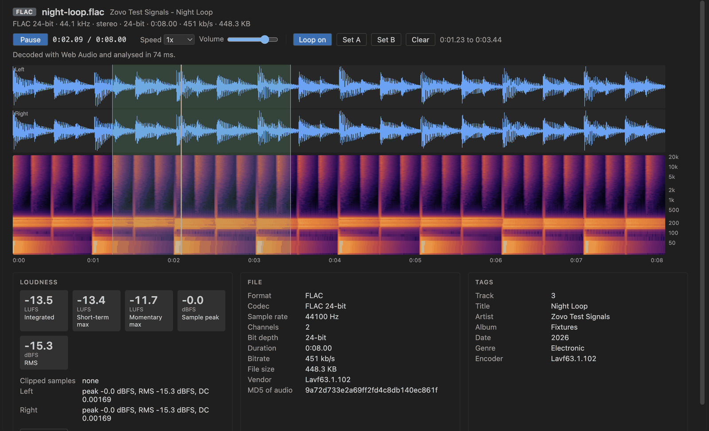
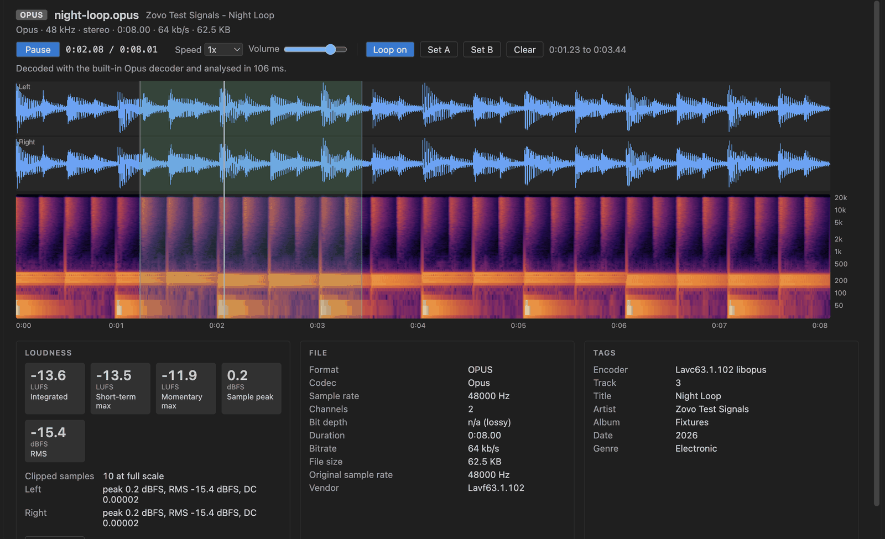
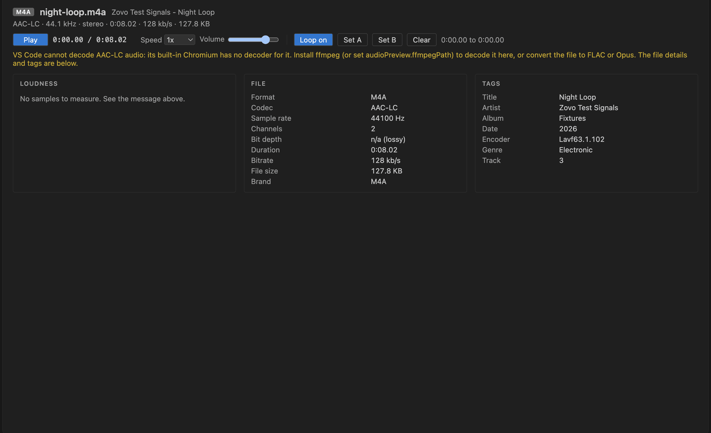

# Audio Player & WAV Player (MP3, FLAC, LUFS)

Click a WAV, MP3, FLAC, Ogg or Opus file and play it with a waveform, a spectrogram, an A-B loop and its LUFS loudness, right inside VS Code.

*Real output from VS Code 1.142 on macOS. The file is `test/fixtures/sweep-44k-s16.wav`, made by `scripts/make-samples.sh`. `scripts/e2e-vscode.mjs` opened it in a real VS Code window, pressed Space, `[` and `]`, and saved the window through the debug port. ffmpeg's ebur128 filter measures the same file at -8.2 LUFS.*

- It gives you a loudness meter, not just a player. Integrated, short-term and momentary loudness follow ITU-R BS.1770-4 and match ffmpeg's ebur128 within 0.1 LU on our test files. Sample peak, RMS, DC offset and clipped samples are listed per channel, and Copy stats puts it all on the clipboard.
- Big WAV files don't freeze the editor. The header and tags show first. The samples are then read in 2 MB chunks, so a 173 MB, 10 minute 24-bit WAV was fully analysed in about 1.3 s in our run.
- It plays Opus, which VS Code can't. VS Code's built-in Chromium has no Opus decoder, so the extension ships libopus compiled to WebAssembly (85 KB, MIT/BSD). FLAC, MP3, Ogg Vorbis and WAV use the decoder VS Code already has.
- It's for checking files, not editing them. Loop a region, slow it to 0.5x without changing the pitch, and read the sample rate, bit depth, codec and tags. Nothing is written back to the file.

## Quick start

1. Install Audio Preview & Loudness Meter.
2. Click any `.wav`, `.mp3`, `.flac`, `.ogg`, `.opus` or `.m4a` file in the Explorer. Press Space to play, then drag across the waveform to loop that part.

If a different audio viewer opens, right-click the file and pick "Open in Audio Preview", or use "Reopen Editor With..." from the editor title menu. "Audio Preview: Get Started" in the Command Palette opens a short tour.

## What you see

The header line gives the codec, sample rate, channels, bit depth, duration, bitrate and file size. Under it sit the transport controls. Play and pause, speed from 0.25x to 2x with the pitch kept, volume, and the loop buttons.

Each channel gets its own waveform lane, up to 8 channels. The spectrogram below it is drawn from a 2048 point FFT on a log frequency axis, so bass notes and hi-hats are both readable. Click anywhere to seek. Hover to read the time.

Three panels sit at the bottom. Loudness has the LUFS and dBFS numbers. File lists format details such as the Xing or LAME header of an MP3, the MD5 stored in a FLAC file, the Opus pre-skip and original rate, or the brand of an M4A. Tags lists title, artist, album, date, genre, track, comment, encoder and any custom fields, from ID3v1, ID3v2.2 to 2.4, RIFF INFO, Vorbis comments and iTunes atoms.

## Keyboard

| Key | Action |
|---|---|
| Space | Play or pause |
| Left, Right | Jump 5 s (1 s with Shift) |
| `[`, `]` | Set loop start or end at the playhead |
| L | Loop on or off |
| Home | Back to the start of the loop or file |
| Double-click | Clear the loop |

## Supported files

| Extension | Decoded by | Notes |
|---|---|---|
| `.wav`, `.wave` | The extension, in chunks | PCM 8, 16, 24 and 32-bit, float 32 and 64-bit, A-law, mu-law, WAVE_FORMAT_EXTENSIBLE, RF64 |
| `.flac` | VS Code (Web Audio) | Any bit depth |
| `.mp3` | VS Code (Web Audio) | Gapless duration from the LAME header |
| `.ogg`, `.oga` | VS Code (Web Audio) | Vorbis. Opus inside `.ogg` is detected and decoded as Opus |
| `.opus` | Bundled libopus (WebAssembly) | Mono, stereo and multichannel mapping |
| `.m4a`, `.aac` | Your ffmpeg, if you have it | Header and tags always show, see below |

### About AAC and M4A

VS Code ships Chromium without an AAC decoder, and we tested this in a real VS Code window. Web Audio and WebCodecs both refuse AAC there. We don't bundle a GPL or LGPL decoder. So for `.m4a` and `.aac` files the viewer shows the codec, duration, bitrate and tags, plus a clear message.

If ffmpeg is installed, a Decode with ffmpeg button appears. One click converts the file to a WAV copy in the extension's storage folder, and you get the full player and loudness meter. The copy is deleted after a day. Set `audioPreview.ffmpegPath` if ffmpeg isn't on your PATH. The setting is machine-wide and is ignored in untrusted workspaces, so a cloned repo can't point it at its own program.

## Large files

| Setting | Default | What it does |
|---|---|---|
| `audioPreview.maxWavMB` | 2048 | WAV files up to this size get the waveform, spectrogram and loudness. Bigger files still play and show their header |
| `audioPreview.maxDecodedMB` | 600 | Compressed files are decoded whole. Above this size of decoded samples (about 28 minutes of 44.1 kHz stereo) the file only plays |
| `audioPreview.maxRemoteFileMB` | 512 | Files in remote or virtual workspaces are read whole |
| `audioPreview.ffmpegPath` | `ffmpeg` | Your own ffmpeg for AAC files. Nothing is bundled or downloaded |
| `audioPreview.askForRating` | `true` | Ask one time for a Marketplace rating, after 5 files and 2 days. Turn it off with `false` |
| `audioPreview.showSupportLinks` | `true` | Show the small Sponsor and More free viewers links under the player |

## Privacy and safety

The extension makes no network calls and has no telemetry. The webview runs under a strict Content Security Policy with no remote scripts and no inline scripts. Tag text from the file is always inserted as plain text, never as HTML, so a tag like `<b>&amp;</b>` shows exactly like that. ffmpeg only runs when you click its button.

## Known limits

- The peak is a sample peak, not an oversampled true peak, and there's no loudness range (LRA) yet.
- Compressed files are decoded whole in the webview, which is why `maxDecodedMB` exists. Only WAV is streamed in chunks.
- ALAC, AC-3 and other codecs VS Code can't decode need the ffmpeg button.

## Support Zovo

Zovo extensions are free, with no ads and no tracking. They are made by [theluckystrike](https://github.com/theluckystrike) on GitHub. If this one saves you time, you can support the work:

- [Sponsor on GitHub](https://github.com/sponsors/theluckystrike)
- [Follow theluckystrike on GitHub](https://github.com/theluckystrike)

## More tools by Zovo

- [MP4 Video Player & Video Preview with Sound](https://marketplace.visualstudio.com/items?itemName=zovo.video-preview-with-sound) plays MP4, MOV, MKV and WebM files with their sound.
- [3D Model Viewer (GLB, glTF, STL, OBJ, PLY)](https://marketplace.visualstudio.com/items?itemName=zovo.3d-model-viewer) views GLB, glTF, STL, OBJ, PLY and 3MF models.
- [Font Viewer & Font Preview (TTF, OTF, WOFF)](https://github.com/theluckystrike/font-viewer-vscode) opens TTF, OTF, WOFF, WOFF2 and TTC fonts with a glyph grid, a type tester with variable axes and the license fields.

See [all Zovo extensions on the Marketplace](https://marketplace.visualstudio.com/publishers/zovo).

## License

MIT. The bundled Opus decoder is [opus-decoder](https://github.com/eshaz/wasm-audio-decoders) (MIT) built from libopus (BSD-3-Clause). See THIRD-PARTY-NOTICES.md.
